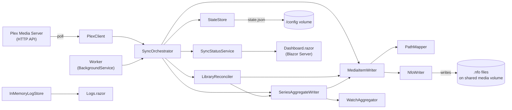

# Architecture

<!-- project:begin architecture -->
This document describes how PlexToJellyfinSync is put together and, where the reasoning is
recoverable from the code or existing docs, *why* it looks the way it does. It complements
[`README.md`](../README.md) (setup and configuration), [`CONTRIBUTING.md`](CONTRIBUTING.md)
(workflow) and [`UNIT_TESTS.md`](UNIT_TESTS.md) (test conventions) rather than repeating them.
The reasoning behind individual decisions — the options considered and the trade-offs accepted — is
recorded in [`decisions/`](decisions/README.md).

What the software guarantees — formats, limits, error behavior — is stated once per area in
[`areas/`](areas/README.md): [Sync pipeline](areas/sync-pipeline.md),
[Path mapping and NFO](areas/path-mapping-and-nfo.md), [Dashboard and auth](areas/dashboard-and-auth.md) and
[Configuration](areas/configuration.md). This document describes the components that implement that behavior
and how they fit together, and links the area that owns a rule instead of restating it.

---

## High-level shape

A single process ships as one Docker image: an ASP.NET Core / Blazor Server host whose only
background job is the `Worker` hosted service. There is no separate API tier, database, or
message queue — configuration, state, and in-memory status/log buffers are all the persistence
the application needs.

Project references form a straight line, `Core ← Data ← Service ← host`, except the host project
depends on `Core` and `Service` but **not** on `Data` directly — the Plex JSON DTOs never need to
be visible outside `PlexToJellyfinSync.Service`, which is the only project that talks to the Plex
API. Every project links the same `src/GlobalSuppressions.cs` (SonarCloud suppressions for
`S1125`, `S2325`, `S1244`, `S6968`) rather than each carrying its own.

The solution file is `.slnx` rather than the legacy `.sln` format — this is the current Visual
Studio standard for solution files, not a migration artifact.

---

## Sync pipeline

What the pipeline does — the schedule, the incremental history run and its high-water mark, the full reconcile,
the owner resolution, the requests made to Plex, the parallelism, the season and series aggregation rule, the
isolation of failures and the run status — is stated in the [Sync pipeline](areas/sync-pipeline.md) area; how a
Plex path becomes a local path and what a write changes in an `.nfo` file is stated in
[Path mapping and NFO](areas/path-mapping-and-nfo.md). This section describes the components that implement it.

1. **`Worker`** (`src/PlexToJellyfinSync/Worker.cs`) is the only `BackgroundService`. It runs the
   [schedule](areas/sync-pipeline.md#polling-and-schedule): one reconcile on startup through
   `SafeReconcileAsync`, then a loop that waits `Sync:PollIntervalSeconds`, calls
   `ISyncOrchestrator.ProcessHistoryAsync` through `SafeProcessHistoryAsync` and, once
   `Sync:FullReconcileIntervalHours` has elapsed, `ISyncOrchestrator.ReconcileAsync` through
   `SafeReconcileAsync`. Both guards log and swallow every error except a cancellation of the worker's own
   stopping token, as defense-in-depth on top of the orchestrator's own error handling, so neither call can
   crash the host; the cancellation still propagates so host shutdown is not reported as a failure (see
   [0013](decisions/0013-worker-guards-both-orchestrator-calls.md)). A `Math.Max` floor on both intervals
   remains as defense-in-depth behind the startup validation. The loop is a plain `while` with `Task.Delay`,
   not a `PeriodicTimer`; each iteration awaits the previous sync call before scheduling the next delay, which
   is what keeps runs from overlapping.
2. **`SyncOrchestrator`** (`src/PlexToJellyfinSync.Service/SyncOrchestrator.cs`) implements both
   sync strategies and delegates to three collaborators (see
   [0018](decisions/0018-sync-orchestrator-split-into-collaborators.md)): the orchestrator owns the
   run lifecycle, the owner-id cache, the incremental history pipeline, the `Plex:Libraries` filter and
   the library-level fan-out; `LibraryReconciler` owns the per-kind reconcile of one library and the
   episode parallelism; `SeriesAggregateWriter` owns the season and series aggregates;
   `MediaItemWriter` owns the path-mapping skip and the NFO write with its created/updated counters.
   All three are stateless singletons:
   - **`ProcessHistoryAsync`** (incremental, every poll) reads the high-water mark from `IStateStore`, calls
     `IPlexClient.GetHistorySinceAsync` for the owner's entries after it, hands each affected item to
     `MediaItemWriter.WriteItemAsync` and advances the mark. Its rules — the first run without a mark,
     paging, the order of the entries — are in the
     [incremental history run](areas/sync-pipeline.md#incremental-history-run).
   - **`ReconcileAsync`** (full, on startup and periodically) walks the configured Plex libraries and hands
     every movie or episode to `MediaItemWriter`, regardless of watch state (the
     [full reconcile](areas/sync-pipeline.md#full-reconcile)). The libraries run concurrently through
     `Parallel.ForEachAsync` in `SyncOrchestrator`, a show's episode writes through `Parallel.ForEachAsync`
     in `LibraryReconciler`; both clamp the configured degree to at least 1 as defense-in-depth behind the
     startup validation, and episodes that share a file are grouped and written sequentially within their
     group ([parallelism](areas/sync-pipeline.md#parallelism)). A library's items are streamed from Plex
     page by page (`IAsyncEnumerable<MediaItem>`, see point 4) rather than materialized up front, so peak
     memory is bounded by a single page instead of the whole library; a show's episodes are still collected
     in full (`ToListAsync`) before being grouped by file, since that grouping needs every episode at once,
     so peak memory there is bounded by one show's episode count.
   - Both paths funnel through `MediaItemWriter.WriteItemAsync`, which resolves the local path via
     `IPathMapper` and skips an item without a mapping or without a file path.
   - `SeriesAggregateWriter.WriteAggregatesAsync` writes the season and series aggregates for every show
     touched by a run, through `WatchAggregator` and `MediaItemWriter`. The episodes come from one listing per
     show and run: `ReconcileAsync` passes the episodes it already listed for the episode writes, while
     `ProcessHistoryAsync` holds no episode list, so the aggregate writer lists the episodes of each touched
     show once itself, streaming them and keeping only the mapped ones (see
     [0018](decisions/0018-sync-orchestrator-split-into-collaborators.md)). When aggregates are written and
     how they are derived is in [season and series aggregates](areas/sync-pipeline.md#season-and-series-aggregates).
   - Both entry points catch and log unexpected exceptions (`HandleError`) rather than letting the `Worker`
     loop die, always reset `SyncStatusViewData.IsRunning` in a `finally` block, and re-throw
     `OperationCanceledException` only when the run's own `CancellationToken` was cancelled. Every per-item
     call (a history entry's item, a reconciled movie or episode, a show's aggregates) is additionally wrapped
     in its own try/catch (`HandleItemError`). What counts as a failed run or a failed item, and what each does
     to the status and the high-water mark, is stated under
     [*Limits and errors*](areas/sync-pipeline.md#limits-and-errors) of the area.
3. **`WatchAggregator`** (`src/PlexToJellyfinSync.Service/WatchAggregator.cs`) has one job: deriving a
   season's or series' watch state from its episodes' `WatchInfo`. It is the single implementation of the
   [aggregation rule](areas/sync-pipeline.md#season-and-series-aggregates).
4. **`PlexClient`** (`src/PlexToJellyfinSync.Service/PlexClient.cs`) is the only component that
   talks to the Plex HTTP API (`GET /accounts`, `/library/sections`,
   `/status/sessions/history/all`, `/library/metadata/{key}`, `/library/metadata/{key}/allLeaves`,
   `/library/sections/{key}/all`). It maps the raw `PlexToJellyfinSync.Data.Plex` DTOs
   (`PlexMetadata`, `PlexDirectory`, …) into the domain model (`MediaItem`, `PlexLibrary`,
   `PlexHistoryEntry`, `WatchInfo`) used by the rest of the app, so Plex's JSON shape never leaks
   past this class. `GetEpisodesAsync` and `GetLibraryItemsAsync` return `IAsyncEnumerable<MediaItem>`
   and request each further page of `X-Plex-Container-Start`/`-Size` lazily, only once the caller has
   consumed the previous page's items (see point 2). `GetOwnerAccountIdAsync` resolves the owner's account
   id; `SyncOrchestrator.ResolveOwnerAsync` caches it and `SyncOrchestrator.HandleError` clears the cache
   after a failed cycle. The resolution order, the fallback id, which failures propagate instead of falling
   back and when the id is resolved again are stated under [*Owner only*](areas/sync-pipeline.md#owner-only);
   what is read from Plex and the limits applied to it under
   [*What is read from Plex*](areas/sync-pipeline.md#what-is-read-from-plex).
5. **`PathMapper`** (`src/PlexToJellyfinSync.Service/PathMapper.cs`) rewrites the Plex-reported file path
   prefix into this container's local mount point and rejects path-traversal forms before matching — the
   file path is the part of the Plex response that flows into a filesystem write path (via `NfoWriter`). The
   matching rules, the rejected forms and the mandatory mapping are stated under
   [*Path mapping*](areas/path-mapping-and-nfo.md#path-mapping) and
   [*Traversal rejection*](areas/path-mapping-and-nfo.md#traversal-rejection).
6. **`NfoWriter`** (`src/PlexToJellyfinSync.Service/NfoWriter.cs`) is the only component that
   touches `.nfo` files on disk. It checks every target against the configured local roots independently of
   `PathMapper`'s own guard, resolves the target per `MediaKind`, updates an existing file through
   `XDocument` (`LoadOptions.PreserveWhitespace`) with `SetChild` comparing each value first, builds a new
   file in `BuildDocument`, and saves every write to a sibling temporary file that replaces the target with
   `File.Move(overwrite: true)`. The rules are stated in [Path mapping and NFO](areas/path-mapping-and-nfo.md):
   [root containment](areas/path-mapping-and-nfo.md#root-containment),
   [targets](areas/path-mapping-and-nfo.md#targets),
   [updating an existing file](areas/path-mapping-and-nfo.md#updating-an-existing-file) (what backs the
   README's promise that in existing `.nfo` files only the watch fields change and every other element keeps
   its content),
   [creating a new file](areas/path-mapping-and-nfo.md#creating-a-new-file),
   [atomic replace](areas/path-mapping-and-nfo.md#atomic-replace) and malformed files under
   [*Limits and errors*](areas/path-mapping-and-nfo.md#limits-and-errors).
   - `WriteAsync` holds a `SemaphoreSlim` keyed by the resolved target path (kept in an
     instance-lifetime `ConcurrentDictionary`, since `NfoWriter` is registered as a singleton) for
     the whole read-modify-write body, not just the temp-file save. This is what makes two writers
     resolving to the same NFO target safe to run concurrently, whether that concurrency comes from
     `LibraryReconciler`'s per-episode `Parallel.ForEachAsync` or from `SyncOrchestrator`'s per-library one
     ([concurrent writers](areas/path-mapping-and-nfo.md#concurrent-writers)). The dictionary never evicts an
     entry — acceptable for a media library's item count, but worth remembering before repurposing this
     pattern for a workload with a much larger or unbounded key space.
7. **`StateStore`** (`src/PlexToJellyfinSync.Service/State/StateStore.cs`) persists the high-water mark.
   Reads and writes both go through a `SemaphoreSlim(1, 1)` gate so concurrent calls (there should only ever
   be one, from `Worker`, but the guard is cheap insurance) cannot interleave a read-modify-write, and a write
   replaces the file through a temporary sibling and `File.Move(overwrite: true)` the same way `NfoWriter`
   does. The file, its atomic replace and the handling of a missing or unreadable file are stated under
   [*State file*](areas/sync-pipeline.md#state-file).
8. **`SyncStatusService`** (`src/PlexToJellyfinSync.Service/SyncStatusService.cs`) holds one
   mutable `SyncStatusViewData` behind a `Lock`, exposes immutable snapshots via `GetSnapshot()`,
   and raises a `Changed` event on every `Update()` so the Blazor dashboard can re-render without
   polling; each subscriber is invoked in isolation, so a throwing handler is logged and skipped instead of
   reaching the sync cycle. `/health` and `Dashboard.razor` both read through this same snapshot; the
   values are described under [*Run status*](areas/sync-pipeline.md#run-status).

---

## Web host & dashboard

The web surface — routes, the `Dashboard:Enabled` switch, the token login with its sessions, cookie and
throttle, the security headers, the forwarded-header trust, the live log buffer and its secret masking — is
stated in the [Dashboard and auth](areas/dashboard-and-auth.md) area. This section describes the components
that implement it.

- **`Program.cs`** (`src/PlexToJellyfinSync/Program.cs`) is the composition root: it adds
  environment variables under the `PLEXSYNC__` prefix ([Configuration](areas/configuration.md#sources)),
  registers `Worker` as a hosted service, registers `InMemoryLogProvider` as an `ILoggerProvider` so every
  `ILogger<T>` call in the app also lands in the dashboard's log buffer, maps the
  [routes](areas/dashboard-and-auth.md#routes) — `GET /health` always, regardless of whether the dashboard
  itself is enabled — and adds the [security headers](areas/dashboard-and-auth.md#security-headers) to every
  response. `InMemoryLogger` runs every captured message and exception through
  `ILogRedactor`/`SecretLogRedactor` before an entry reaches the store. `Program.cs` also logs the startup
  warning for a dashboard without a token and calls `UseForwardedHeaders` with the options of
  `Security/DashboardStartup.cs`, which build the trusted senders from `Dashboard:TrustedProxies` on top of the
  framework's loopback defaults (see [decision 0022](decisions/0022-forwarded-headers-from-configured-proxies-only.md));
  which headers that trusts, from whom, and what follows
  for the login throttle and the cookie is stated under
  [*Forwarded headers*](areas/dashboard-and-auth.md#forwarded-headers) and the area's
  [*Limits and errors*](areas/dashboard-and-auth.md#limits-and-errors).
- The CSP's `'unsafe-inline'` for script/style and `wss:`/`ws:` for `connect-src` are required for Blazor
  Server's SignalR circuit and inline bootstrap script, not a relaxed default.
- **`Dashboard:Enabled`** gates the entire interactive surface: when `false`, only `/health` is
  mapped and nothing else (no Razor components, no login endpoints, no antiforgery/status-code
  middleware) — there is no dashboard to secure in that mode. When `true`, the pipeline adds
  `UseAntiforgery`, `TokenAuthMiddleware`, the Razor component endpoints
  (`AddInteractiveServerRenderMode`), and the `/login` GET/POST and `/logout` POST endpoints.
- **`TokenAuthMiddleware`** (`src/PlexToJellyfinSync/Security/TokenAuthMiddleware.cs`) is a
  no-op pass-through when `Dashboard:Token` is unset — the dashboard is unauthenticated by
  default, consistent with `SECURITY.md`'s framing of this as a home-network tool. When a token
  is configured, every request outside the [public paths](areas/dashboard-and-auth.md#with-a-dashboard-token)
  must carry a session cookie that resolves to a live entry in `IMemoryCache`. Blazor's `/_blazor` SignalR
  hub is deliberately public, since it only serves negotiate/connect for a circuit whose initial page render
  already passed authentication. Sessions are therefore server-side and revocable by cache eviction, not
  self-contained bearer tokens.
- **`DashboardLoginService`** (`src/PlexToJellyfinSync.Service/Security/DashboardLoginService.cs`)
  compares the submitted token to the configured one via `TokenComparer.FixedTimeEquals` — both
  inputs are SHA-256-hashed first (removing any length side-channel) before a constant-time
  `CryptographicOperations.FixedTimeEquals` on the hashes — and, on success, mints a random session id
  (`RandomNumberGenerator`). Failed attempts go through `LoginThrottle`
  (`src/PlexToJellyfinSync.Service/Security/LoginThrottle.cs`), which keeps at most 1024 records in memory, prunes
  idle ones when admitting a new client to a full record set instead of with a background sweep timer, and
  counts further clients on one shared record; its counting, backoff, pruning and bound
  rules are stated under [*Login throttle*](areas/dashboard-and-auth.md#login-throttle).
  **`LoginEndpoints.HandleLoginAsync`** (`src/PlexToJellyfinSync/Security/LoginEndpoints.cs`) is the HTTP
  glue: it turns `LockedOut` into `429` with `Retry-After`, stores a `Succeeded` login's session id in
  `IMemoryCache` under `pjf_session:<id>` and sets the `pjf_auth` cookie, and redirects a `Failed` one back to
  `/login?error=1`. The cookie carries `Secure` only when the request itself counts as HTTPS
  (`Request.IsHttps`), because a hardcoded `Secure` flag would make the cookie silently dropped, and the
  dashboard therefore unusable, behind the project's own documented plain-HTTP quick start; lifetime and flags
  are stated under [*Sessions and cookie*](areas/dashboard-and-auth.md#sessions-and-cookie).
  **`LoginEndpoints.HandleLogout`** clears the cache entry and the `pjf_auth` cookie and redirects to
  `/login`; `MainLayout.razor` renders a logout link (posting to `/logout` with an antiforgery token via the
  `<AntiforgeryToken />` component) whenever a dashboard token is configured. The `GET /login` endpoint
  mints an antiforgery token pair (`IAntiforgery.GetAndStoreTokens`) and embeds a hidden field for it in the
  rendered page, and the `POST /login`/`POST /logout` endpoints validate that token like every other
  endpoint — neither is exempted via `DisableAntiforgery`.
- **`Dashboard.razor`** subscribes to `ISyncStatusProvider.Changed` in `OnInitialized` and
  unsubscribes in `Dispose`, re-reading the snapshot and re-rendering inside `InvokeAsync` whenever
  the orchestrator updates the status (`Changed` is raised on the sync worker's thread, so component
  state is only mutated on the renderer's dispatcher) — the dashboard is push-updated, not polling. **`Logs.razor`**
  follows the same pattern against `ILogStore`/`InMemoryLogStore`, a fixed-capacity ring buffer
  (`Queue<LogEntry>` behind a `Lock`) rather than unbounded storage — log history is intentionally ephemeral
  and capped, not a substitute for an external log sink. Its capacity, what enters it and what the masking
  covers are stated under
  [*Live log buffer and secret masking*](areas/dashboard-and-auth.md#live-log-buffer-and-secret-masking).

---

## Configuration & dependency injection

The settings an operator sets — sources, keys, environment variables, defaults, allowed values and the startup
check — are stated in the [Configuration](areas/configuration.md) area; the configuration table in
[`README.md`](../README.md#configuration) is the users' setup reference and agrees with it. This section
describes how the settings reach the code.

- **`ServiceCollectionExtensions.AddPlexToJellyfinSync`**
  (`src/PlexToJellyfinSync.Service/ServiceCollectionExtensions.cs`) is the single DI registration
  point for everything under `PlexToJellyfinSync.Service`: it binds every `Options` class to its
  configuration section, registers every service as a singleton (the whole pipeline is one
  sequential background worker — there is no per-request or per-scope service in the sync path),
  and configures the Plex `HttpClient` (base address, `X-Plex-Token` header, `Accept:
  application/json` and the request timeout of [*What is read from Plex*](areas/sync-pipeline.md#what-is-read-from-plex))
  via `AddHttpClient(nameof(IPlexClient), …)`. This is a *named*
  client rather than a typed client (`AddHttpClient<IPlexClient, PlexClient>`) on purpose:
  `PlexClient` is itself a singleton, so a typed client's single `HttpClient` instance would be
  captured for the process's lifetime and `IHttpClientFactory`'s handler rotation would never take
  effect. Instead `PlexClient` holds the injected `IHttpClientFactory` and calls
  `CreateClient(nameof(IPlexClient))` for every outgoing request.
- All options classes live in `PlexToJellyfinSync.Core.Options` and bind to a `SectionName`
  matching their configuration key (`Plex`, `Sync`, `Nfo`, `State`, `Dashboard`); `PathMappings`
  binds directly to `List<PathMapping>` at the configuration root rather than through a named
  options section, which is why it appears as `PathMappings:N:Plex`/`:Local` rather than nested
  under another key.
- `PlexOptions`, `SyncOptions`, `StateOptions` and `DashboardOptions` are registered with
  `ValidateDataAnnotations().ValidateOnStart()`; required settings and ranges are declared as
  attributes on the options classes. What is checked, and how a violation stops the start, is stated under
  [*Startup check*](areas/configuration.md#startup-check). See
  [0016](decisions/0016-options-validated-at-startup.md) and
  [0017](decisions/0017-plex-token-stays-optional.md).

---

## Deployment

The container contract an operator relies on — image coordinates, port, volumes and the non-root user — is
stated under [*Container*](areas/configuration.md#container) in the Configuration area. This section describes
how the image is built and released.

- Single multi-stage `Dockerfile` at the repo root: `dotnet/sdk:10.0-alpine` build stage restores
  and publishes `src/PlexToJellyfinSync`, then copies the publish output onto
  `dotnet/aspnet:10.0-alpine` (pinned by digest, with the tag kept alongside for readability).
  `ASPNETCORE_URLS` fixes the listening address inside the container, and the final stage runs as the base
  image's predefined non-root user (`USER $APP_UID`) rather than root.
- **CI** (`.github/workflows/ci.yml`) restores, builds, runs tests with coverage
  (`XPlat Code Coverage`, OpenCover format), and — when `SONAR_TOKEN` is available (not exposed to
  Dependabot or fork PRs) — feeds the coverage into SonarQube Cloud analysis
  (`networlddev_PlexToJellyfinSync`). CI deliberately does **not** check formatting: formatting, Reihitsu
  and Sonar diagnostics are cleared before a push (in the squad, the member that changed the files formats
  them and the Code Officer clears analyzer diagnostics), with the `SonarAnalyzer.CSharp` rules running in
  every local build — see [decision 0009](decisions/0009-quality-gates-before-the-pull-request.md) and
  [decision 0020](decisions/0020-squad-member-who-changed-files-runs-the-formatter.md).
- **CodeQL** (`.github/workflows/codeql.yml`) runs on push/PR to `main` and weekly on a schedule,
  analyzing both C# and JavaScript/TypeScript in `build-mode: none` (no compiled build needed for
  CodeQL's extraction).
- **Dependabot** (`.github/dependabot.yml`) checks weekly for `github-actions`, `nuget`, and
  `docker` updates, each grouped into a single PR per ecosystem (capped at 10 open PRs) instead of
  one PR per dependency.
- **Release** (`.github/workflows/release.yml`) triggers only on a manually pushed `v<major>.<minor>.<patch>`
  tag — merging a PR into `main` never publishes a release by itself. The version comes directly
  from the tag name; there is no automatic version computation. On such a tag push, it builds and
  pushes a multi-arch (`linux/amd64,linux/arm64`) image to Docker Hub
  (`networlddev/plextojellyfinsync:<version>` and `:latest`), the only registry the project publishes to
  ([decision 0015](decisions/0015-container-images-on-docker-hub-only.md)). The GitHub release itself (with its
  tag) is created manually via the GitHub UI, which is what triggers this workflow in the first
  place.

## Undocumented decisions

If a future change introduces a decision without a stated reason, record it as a decision record in
[`decisions/`](decisions/README.md) instead of leaving the gap for the next person. None are currently
outstanding.
<!-- project:end architecture -->

## Development process

This repository is developed with Claude Code: `AGENTS.md` holds the rules every AI coding agent reads, the
skills live under `.claude/skills/` and the squad roles under `.claude/agents/`. Every pull request is reviewed
before it is opened by the read-only reviewer in `.claude/agents/squad-reviewer.md`. The squad skills
(`squad-issue`, `squad-spec`) wrap that review in a bounded pipeline described in
[`.squad/routing.md`](../.squad/routing.md): a Lead plans, picks the tier that decides how much of the pipeline
runs and owns every decision; a Devil's Advocate challenges a feature's spec and, when routing says so, the
plan; Security reviews the plan when a security area is touched; tests come first, the gates run before the
review, and every loop limit ends in a Lead decision — only one the Lead cannot make reaches the human. The stack's commands live in
[`.squad/stack.md`](../.squad/stack.md), the project's guarantees and attack surface in
[`.squad/project.md`](../.squad/project.md).

The reasoning behind individual choices is kept out of this document and recorded instead as decision
records in [`docs/decisions/`](decisions/README.md); this document describes how the system works and
links a record where a guarantee or flow is the result of one.
